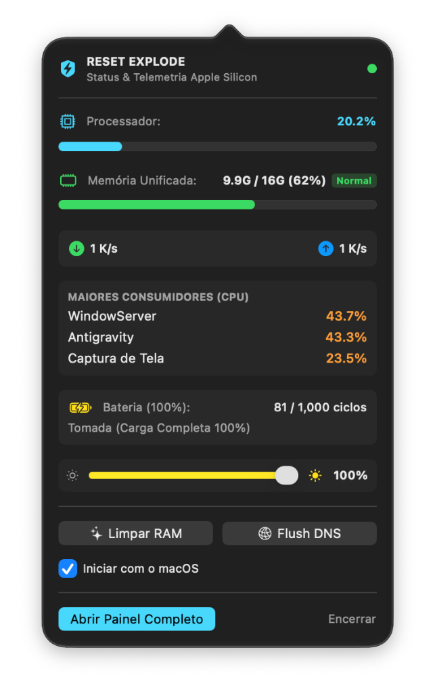
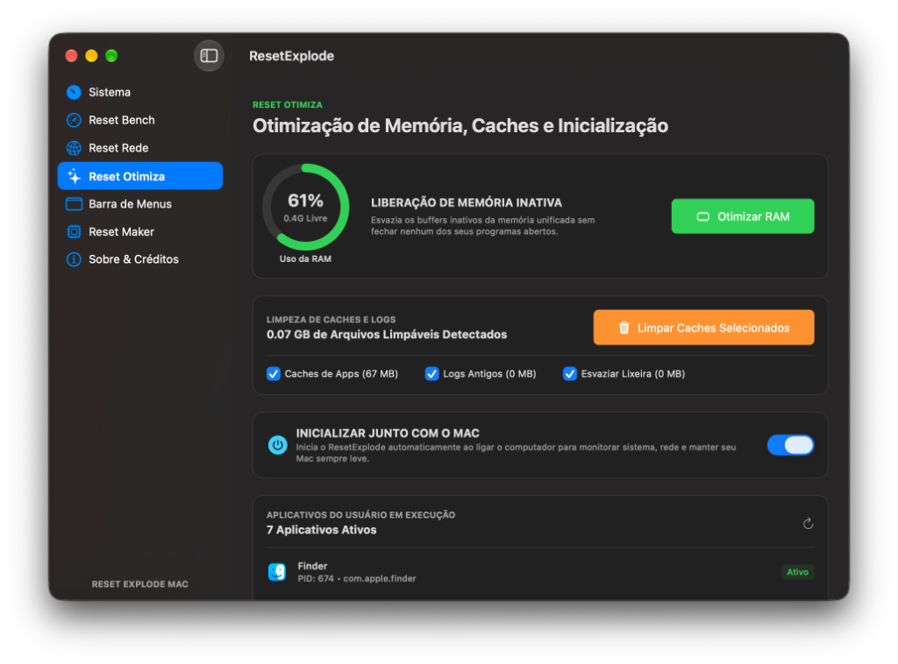
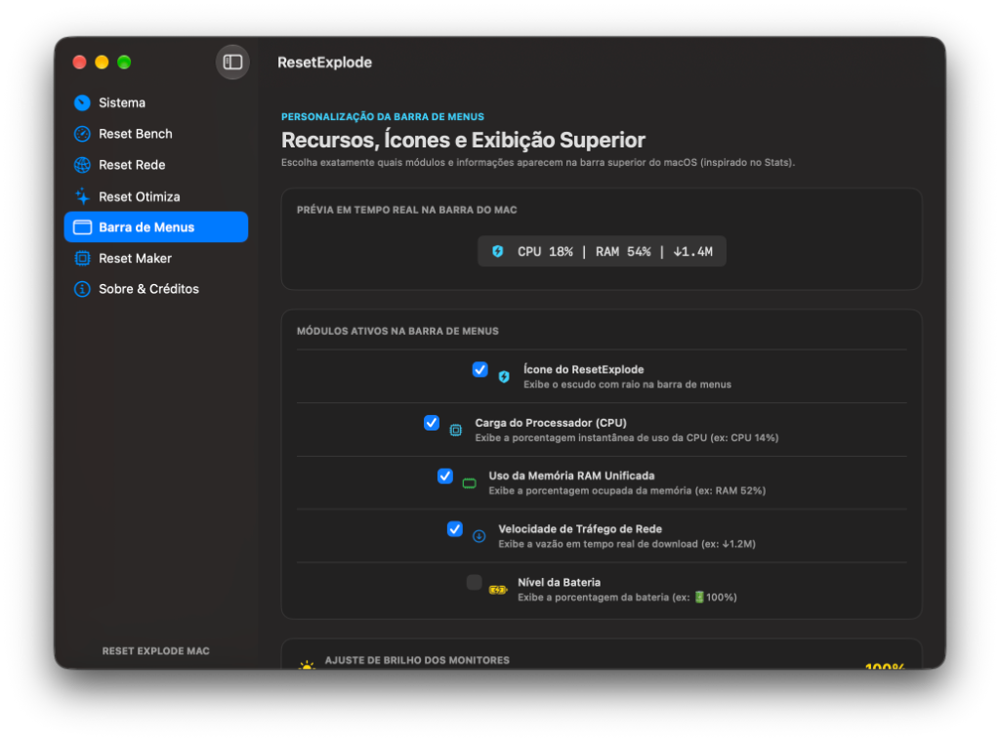
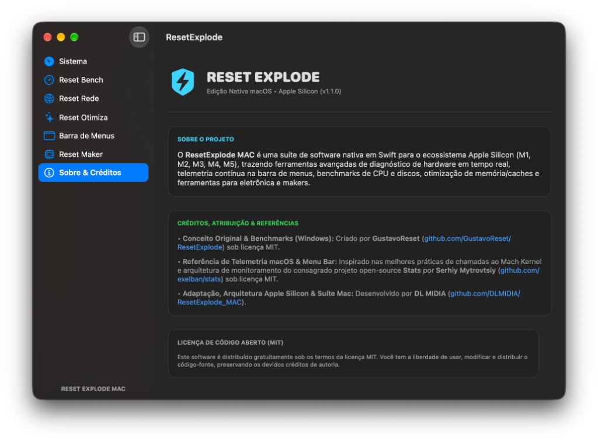

<p align="center">
  
</p>

<h1 align="center">⚡ ReStats — macOS Hardware Telemetry & Benchmark Suite 🍏</h1>

<p align="center">
  <strong>A fusão definitiva entre o poder bruto de benchmark do <em>ResetExplode</em> e a precisão elegante da telemetria do <em>Stats</em>.</strong>
</p>

<p align="center">
  <a href="https://www.apple.com/macos/"></a>
  <a href="https://www.apple.com/mac/"></a>
  <a href="https://swift.org/"></a>
  <a href="https://github.com/DLMIDIA/ResetExplode_MAC/releases"></a>
  <a href="LICENSE"></a>
</p>

---

## 💡 A Filosofia do ReStats: Por Que Reset + Stats?

<p align="center">
  
</p>

O **ReStats** foi concebido a partir de uma constatação simples: usuários e entusiastas do ecossistema Mac precisavam de uma ferramenta única que unisse:
1. **O espírito de estresse e diagnóstico do [ResetExplode](https://github.com/GustavoReset/ResetExplode) (por GustavoReset):** Benchmarks determinísticos reais, renderização volumétrica com raytracing na CPU, largura de banda STREAM da memória unificada em GB/s, testes de I/O em discos ignorando caches falsos (`F_NOCACHE`), e ferramentas completas para prototipagem eletrônica e makers.
2. **A sutileza e sofisticação de telemetria do [Stats](https://github.com/exelban/stats) (por Serhiy Mytrovtsiy):** Chamadas de ultra-baixo nível ao **Mach Kernel** (`host_processor_info`), monitoramento individual de núcleos de Performance (P-Cores) e Eficiência (E-Cores), integração modular e contínua com a **Barra de Menus** do macOS e consumo elétrico praticamente nulo (< 0.1% CPU).

O resultado é o **ReStats**: uma aplicação nativa compilada em Swift 6, com binário de menos de 1 MB, design moderno com glassmorphism, suporte nativo a toda a linha Apple Silicon (M1 até M5) e zero dependências pesadas.

---

## 📸 Galeria de Interface & Recursos Reais (macOS Apple Silicon)

<p align="center">
  
  <br>
  <em>Painel Principal: Detecção de chip Apple M5, carga individual por núcleo (P-Cores e E-Cores), memória e monitor de processos em tempo real.</em>
</p>

<br>

<table align="center" width="100%">
  <tr>
    <td width="35%" align="center" valign="top">
      <strong>⏱️ Popover da Barra de Menus</strong><br><br>
      
      <br><em>Acesso rápido: CPU, RAM, rede, processos pesados, bateria, brilho e atalhos de limpeza.</em>
    </td>
    <td width="65%" align="center" valign="top">
      <strong>🚀 Otimização de Memória & Caches</strong><br><br>
      
      <br><em>Liberação de memória inativa e limpeza segura de arquivos temporários e logs do Mac.</em>
    </td>
  </tr>
  <tr>
    <td width="50%" align="center" valign="top">
      <strong>🎛️ Personalização da Barra de Menus</strong><br><br>
      
      <br><em>Escolha quais módulos exibir no topo do Mac com prévia ao vivo e controle de brilho.</em>
    </td>
    <td width="50%" align="center" valign="top">
      <strong>📜 Filosofia, Origem & Créditos</strong><br><br>
      
      <br><em>Atribuição formal a GustavoReset (ResetExplode) e Serhiy Mytrovtsiy (Stats).</em>
    </td>
  </tr>
</table>

---

## 🚀 Como Instalar (Instalador DMG Pronto)

A instalação no macOS é instantânea:

1. Baixe o instalador oficial **[`ReStats-AppleSilicon.dmg`](https://github.com/DLMIDIA/ResetExplode_MAC/releases)**.
2. Dê um duplo clique no arquivo `.dmg` para montá-lo.
3. Arraste o ícone do **ReStats** para a pasta **Applications** (Aplicativos).
4. Abra o **ReStats** a partir do Launchpad ou da pasta de Aplicativos.

> **Dica:** O ReStats pode ser configurado com 1 clique para iniciar silenciosamente junto com o macOS, mantendo suas leituras de temperatura, rede, RAM e bateria sempre visíveis no topo da tela.

---

## 🌟 Principais Recursos e Módulos

### 1. ⏱️ Status Modular na Barra de Menus (Inspirado no Stats)
* **Customização Total de Módulos (Aba Barra de Menus):** Escolha livremente quais informações devem habitar o topo do seu Mac:
  * Ícone estilizado do ReStats (`⚡`)
  * Carga percentual da CPU (`CPU 12%`)
  * Uso de memória RAM (`RAM 48%`)
  * Tráfego de download/upload em tempo real (`↓ 2.4M`)
  * Percentual e ícone dinâmico da bateria (`🔋 98%`)
* **Pré-Visualização em Tempo Real:** Visualize como a barra ficará antes de aplicar as mudanças.
* **Painel Popover Flutuante:** Clique no ícone do menu para acessar:
  * Medidor de carga da CPU e uso de memória.
  * Indicador de **Pressão de Memória** (Normal / Atenção / Crítica) e uso de Swap do macOS.
  * Velocímetro de download e upload ao vivo.
  * **Top 3 processos** mais pesados consumindo CPU (amostrados em background sem travar a UI).
  * **Controle Deslizante de Brilho dos Monitores** (DisplayServices).
  * Botões de ação rápida: **Limpeza de Memória RAM** e **Flush DNS**.
* **Execução Não-Invasiva:** Fechar a janela principal não encerra o app; ele continua rodando levemente na barra de menus 24/7.

---

### 2. 💻 Sistema & Sensores Apple Silicon
* **Processadores Apple Silicon & Monitoramento Núcleo a Núcleo:**
  * Reconhecimento automático dos chips Apple **M1, M2, M3, M4 e M5** (incluindo variantes Pro, Max e Ultra).
  * Leitura direta no Mach Kernel (`host_processor_info`) para exibir o percentual de carga individual de cada **P-Core (Performance)** e **E-Core (Eficiência)**.
* **Memória Unificada & Pressão:**
  * Divisão exata entre memória ativa, presa (*wired*), comprimida e livre.
  * Diagnóstico de Swap em disco (`vm.swapusage`) e nível de pressão do kernel (`memorystatus_vm_pressure_level`).
* **Ajuste de Brilho dos Monitores (DisplayServices):**
  * Controle direto do backlight da tela integrada e monitores externos conectados via DisplayServices API, com presets de 25%, 50%, 75% e 100%.
* **Saúde & Diagnóstico de Bateria (IOKit):**
  * Contagem exata de **ciclos de recarga** (ex: `81 / 1000 ciclos`).
  * **Saúde Real (%)** baseada na capacidade de projeto de fábrica.
  * Status dinâmico: na bateria, carregando ou conectado à tomada em carga completa.
* **Periféricos & Dispositivos Conectados:**
  * Monitores externos com resolução e taxa de atualização (Hz).
  * Interfaces USB, microfones, placas de som e hubs.
  * Fones e periféricos Bluetooth (AirPods, teclados) lidos de forma assíncrona sem risco de travamentos por permissões TCC.
* **Discos Rígidos e Partições:**
  * Mapeamento completo de volumes APFS, drives externos USB-C/Thunderbolt e volumes de rede.

---

### 3. ⚡ ReStats Bench (Benchmarks Determinísticos e Profundos)
* **CPU Path Tracer (Multi-Core & Single-Core Calibrados):**
  * Motor de renderização volumétrica baseado no método de Monte Carlo com sombreamento Phong e reflexões.
  * **Sem Falso Positivo / Sem DCE:** Alocação de buffer físico de pixels ARGB de 32 bits que impede o compilador LLVM de eliminar o loop em compilações de Release.
  * Duração realista de 4 a 6 segundos por teste, produzindo pontuações autênticas e fidedignas.
  * Visualização gráfica de *buckets* em tempo real.
* **STREAM Memory Benchmark (Largura de Banda & Latência):**
  * Medição real de vazão da Memória Unificada em **GB/s**.
  * Medição de latência de acesso à memória em nanossegundos (**ns**) via algoritmos de *pointer chasing*.
* **Benchmark de Armazenamento Físico:**
  * **Layout em 2 Colunas Responsivas:** Sem cortes de tela ou cartões espremidos.
  * Suporte a teste em qualquer partição interna ou externa.
  * **Leitura e Escrita Sequencial (MB/s):** Acesso físico direto com flag `F_NOCACHE` para ignorar o buffer de memória do SO.
  * **Leitura e Escrita Aleatória 4K (IOPS):** Mede a agilidade real do SSD ao abrir apps pesados e carregar bibliotecas.

---

### 4. 🌐 ReStats Rede (Speedtest CDN, Latência & Diagnóstico)
* **Teste de Velocidade de Internet Integrado (Speedtest Cloudflare CDN):**
  * Medição precisa de **taxa de download em Mbps**, **vazão em MB/s** e **latência de ping**.
  * Gráfico e barra de progresso em tempo real durante a transferência.
* **Velocímetro de Tráfego de Rede:** Medição ao vivo de tráfego de entrada e saída.
* **Ping / Latência ao Vivo:** Monitoramento contínuo dos servidores Cloudflare (1.1.1.1) e Google (8.8.8.8) com avaliação qualitativa (Excelente, Bom ou Lento).
* **Flush DNS com 1 Clique:** Esvazia e recarrega os caches locais de resolução de nomes (`dscacheutil` e `mDNSResponder`).

---

### 5. 🚀 ReStats Otimiza (RAM, Caches & Organizador)
* **Organizador Inteligente de Mesa (Desktop) & Downloads:**
  * Integração nativa do algoritmo de organização automática em **7 categorias estruturadas**:
    1. `01 - Projetos & Sistemas` (repositórios git, código, Node, Python, Docker)
    2. `02 - Orçamentos & Contratos` (propostas comerciais, contratos, orçamentos, minutas)
    3. `03 - Fotos, Vídeos & Drone` (vídeos brutos, mídias soltas, fotos de drones DJI e câmeras)
    4. `04 - Design & Artes` (editáveis PSD, AI, Figma, SVG e peças gráficas finalizadas)
    5. `05 - Documentos & PDFs` (PDFs, planilhas Excel, Word, apresentações e textos)
    6. `06 - Capturas e Gravações de Tela` (prints de tela e vídeos de gravação)
    7. `07 - Backups & Arquivos` (arquivos .zip, .dmg, .pkg, instaladores e compactados)
  * Botões de ação rápida para organizar apenas a **Mesa**, apenas a pasta **Downloads** ou **Ambos com 1 Clique**.
  * Acesso instantâneo tanto no painel principal quanto no **Popover da Barra de Menus**.
* **Liberação de Memória Inativa:** Esvazia buffers inativos da RAM unificada sem fechar nenhum aplicativo em execução.
* **Limpeza Segura de Caches e Logs:** Remove arquivos temporários de `~/Library/Caches` e `~/Library/Logs`, liberando múltiplos gigabytes de armazenamento.
* **Inicialização com o Mac:** Integração com o subsistema nativo `SMAppService` da Apple.

---

### 6. 🍅 Produtividade & Energia (Inspirado no Vorssaint)
* **Timer Pomodoro (Foco Profundo & Ritmo):**
  * Ciclos calibrados: **Foco (25 min)**, **Pausa Curta (5 min)** e **Pausa Longa (15 min)**.
  * Anel de progresso visual com gradiente dinâmico e aviso sonoro ao término de cada etapa.
  * Integração opcional com a **Barra de Menus** do Mac (`⏱️ 24:15`), permitindo acompanhar seu tempo sem abrir a janela.
* **Desligamento & Repouso Programado (Sleep/Shutdown Timer):**
  * Agende o desligamento automático do Mac após processos longos de renderização ou downloads pesados à noite.
  * Presets rápidos: **30 min**, **1 hora**, **2 horas**, **4 horas** ou em **horário exato** do relógio.
  * Ações suportadas: Desligar (`Shut Down`), Repouso (`Sleep`) ou Reiniciar (`Restart`).
  * Contagem regressiva em tempo real com botão de cancelamento a qualquer momento.
* **Verificador de Atualizações do macOS:**
  * Checagem em background de pacotes e patches pendentes no catálogo da Apple (`softwareupdate --list`).
  * Atalho direto para os Ajustes do Sistema.

---

## 📊 Tabela de Referência de Benchmarks de CPU

| Processador | Arquitetura | Single-Core (pts) | Multi-Core (pts) | Vazão de Memória |
| :--- | :---: | :---: | :---: | :---: |
| **Apple M4 Max** | 16-Core ARM | ~3.850 | ~26.400 | ~410 GB/s |
| **Apple M4 Pro** | 14-Core ARM | ~3.750 | ~21.500 | ~273 GB/s |
| **Apple M4** | 10-Core ARM | ~3.700 | ~14.800 | ~120 GB/s |
| **Apple M3 Max** | 16-Core ARM | ~3.150 | ~21.800 | ~300 GB/s |
| **Apple M3** | 8-Core ARM | ~3.050 | ~11.900 | ~100 GB/s |
| **Apple M2** | 8-Core ARM | ~2.600 | ~9.800 | ~100 GB/s |
| **Apple M1** | 8-Core ARM | ~2.300 | ~8.400 | ~68 GB/s |
| *Intel Core i9-14900K* | 24-Core x86 | ~3.100 | ~22.500 | ~90 GB/s |
| *AMD Ryzen 9 7950X* | 16-Core x86 | ~2.950 | ~20.800 | ~80 GB/s |

---

## 🛠️ Como Compilar pelo Código-Fonte

Caso queira compilar o ReStats a partir do código-fonte:

```bash
# 1. Clonar o repositório
git clone https://github.com/DLMIDIA/ResetExplode_MAC.git
cd ResetExplode_MAC

# 2. Compilar binário Release nativo Apple Silicon
cd mac
swift build -c release

# 3. Gerar o pacote .DMG oficial
cd ..
./package_dmg.sh
```

O arquivo `ReStats-AppleSilicon.dmg` estará disponível na raiz do repositório.

---

## ⚖️ Créditos, Referências & Agradecimentos

O **ReStats** é um projeto de código aberto que homenageia e se apoia no trabalho de desenvolvedores brilhantes:

| Autor / Projeto | Contribuição | Repositório | Licença |
| :--- | :--- | :---: | :---: |
| **GustavoReset** (*ResetExplode*) | Conceito original para Windows, suíte de benchmarks, testes de estresse e ecossistema Maker. | [GitHub](https://github.com/GustavoReset/ResetExplode) | MIT |
| **Serhiy Mytrovtsiy** (*Stats*) | Referência máxima de telemetria macOS, arquitetura de chamadas Mach Kernel e design de Menu Bar. | [GitHub](https://github.com/exelban/stats) | MIT |
| **Vorssaint** (*Vorssaint-Utils*) | Inspiração em utilitários de produtividade macOS, automação de foco Pomodoro e ferramentas de desenvolvedor. | [GitHub](https://github.com/vorssaint/vorssaint-utils) | MIT |
| **Daniel Júnior Barbosa da Silva** (*DL MIDIA*) | Idealização e fusão arquitetural no ReStats, desenvolvimento nativo em Swift 6, engenharia para Apple Silicon M-Series, controle avançado de hardware DDC/CI e distribuição. | [GitHub](https://github.com/DLMIDIA/ResetExplode_MAC) | MIT |

---

## 📄 Licença

Distribuído sob a licença **MIT**. Consulte o arquivo [`LICENSE`](LICENSE) para obter todos os detalhes.
